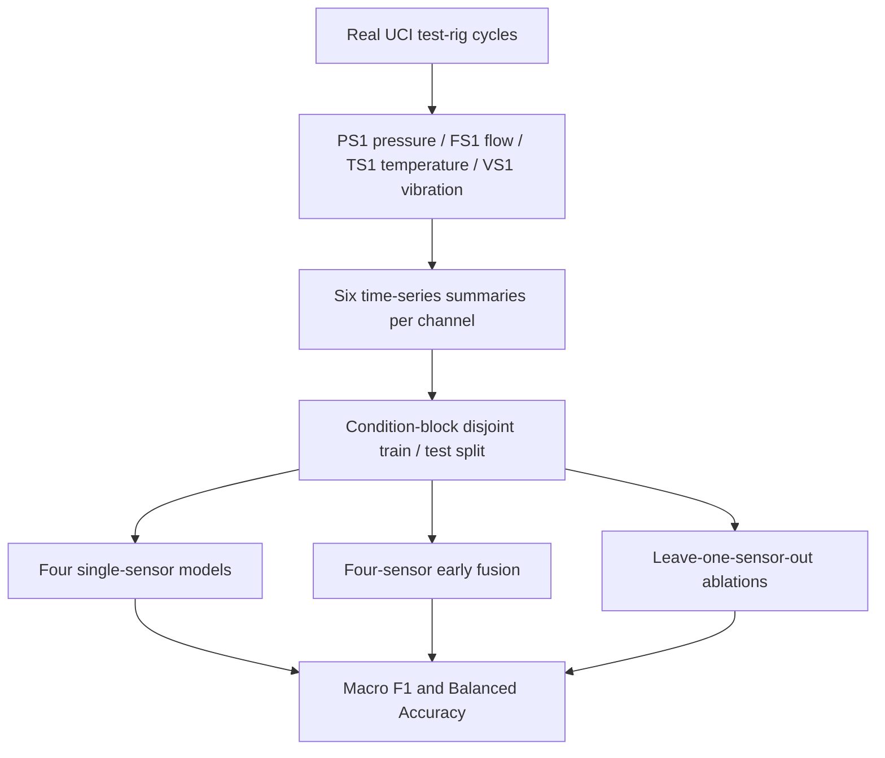

# Hydraulic Test-Rig Sensor Fusion: A Leakage-Aware Mini-Benchmark

**Research software mini-project | Python · multivariate time series · feature-level sensor fusion · fault-state classification**

> Four sensor modalities (pressure, flow, temperature, vibration) recorded on a **real industrial hydraulic test rig**. The outcome is **valve condition**, not general future failure prediction. **Block-disjoint evaluation is used because randomly splitting adjacent cycles can give misleadingly high results.**

**Publication status (2026-10-23):** source code and artificial-fixture unit tests prepared; no measured performance on the original UCI dataset is published yet. Independent project, not affiliated with ADaMS Lab or University of Alberta.

## Goal

Compare the value of pressure, flow, temperature, and vibration alone vs concatenating their cycle-level features; study which sensor's exclusion affects classification. This is an **early feature fusion** baseline, not raw-stream synchronization or adaptive model fusion.

## Dataset credit

[UCI Condition Monitoring of Hydraulic Systems](https://archive.ics.uci.edu/dataset/447/condition+monitoring+of+hydraulic+systems) / DOI **10.24432/C5CW21** (Helwig, Pignanelli & Schütze; CC BY 4.0). 2205 cycle rows, 60 s/cycle. The full ZIP is approximately **73 MB** compressed; uncompressed text sensor matrices are much larger. Not bundled.

| Sensor | Measurement | Native rate | Samples/cycle |
|---|---|---:|---:|
| PS1 | pressure (bar) | 100 Hz | 6000 |
| FS1 | volume flow (L/min) | 10 Hz | 600 |
| TS1 | temperature (°C) | 1 Hz | 60 |
| VS1 | vibration (mm/s) | 1 Hz | 60 |

Valve labels: 100 optimum / 90 slight lag / 80 severe lag / 73 near failure. Label comes from column 2 of `profile.txt`. Other `profile.txt` columns are **not predictors**.

## Experimental architecture



## Study design and improvements over a naïve notebook

- Process complete 60-s cycles, not individual time samples, as observations.
- Extract 6 features per channel: mean, std, min, max, RMS, second-vs-first-half mean.
- **Primary holdout:** contiguous settings derived from runs of identical full `profile.txt` vectors are disjoint between train/test. This is stronger than a random cycle split, although not complete inter-machine independence.
- Compare **majority classifier + 4 single sensors + 4-sensor fusion + 4 leave-one-sensor-out ablations**.
- Fixed RF baseline and training-only imputation; report macro-F1, balanced accuracy and confusion matrix.
- Optional random cycle split clearly labeled **potentially leaky**, not primary findings.
- Save class counts, block counts and configuration metadata for reproducibility.

## Quick start: PowerShell (Windows)

```powershell
py -3.12 -m venv .venv
.\.venv\Scripts\python.exe -m pip install -r requirements.txt
.\.venv\Scripts\python.exe scripts\get_data.py
.\.venv\Scripts\python.exe -m hydraulic.run --seeds 42 52 62
.\.venv\Scripts\python.exe -m pytest -q
```

UCI inaccessible through script? Download ZIP yourself in the browser, then:

```powershell
.\.venv\Scripts\python.exe scripts\get_data.py --archive "C:\Users\You\Downloads\data.zip"
.\.venv\Scripts\python.exe -m hydraulic.run --seeds 42 52 62
```

Or if TXT files were extracted to a directory:

```powershell
.\.venv\Scripts\python.exe -m hydraulic.run --source data/raw --seeds 42
```

Optional diagnostics (not used as headline numbers):

```powershell
.\.venv\Scripts\python.exe -m hydraulic.run --seeds 42 --include-naive
.\.venv\Scripts\python.exe -m hydraulic.run --seeds 42 --stable-only --output results/stable
```

Linux/macOS: use `python -m venv .venv`, `.venv/bin/python` instead of the Windows Python path.

## Artifacts

- `results/model_comparison.csv` and `results/results_by_seed.csv`
- `results/fusion_comparison.png`
- `results/confusion_grouped_seed_42.png`, `results/classification_report_seed_42.txt`
- `results/importance_exploratory.csv` and `results/run_metadata.json`
- `results/RESULTS.md`, a generated table plus interpretation questions

Results are excluded from Git by default. After inspecting **real** UCI outputs, explicitly stage selected outputs, e.g. `git add -f results/RESULTS.md results/fusion_comparison.png results/model_comparison.csv`.

## Limits / questions to discuss

1. Does 4-sensor fusion beat the *best* single sensor? (Do not assume.)
2. How much does it degrade when FS1 or another sensor is left out?
3. Are 90% small-lag valves confused with 100% optimal more often than severe conditions?
4. All cycles come from one rig and some conditions may repeat. Predicting the labelled condition is not proof of fault localization or field-ready generalization.
5. The experiment is **not WAAM metal printing** and cannot be represented as data collected in ADaMS Lab.

See [the experiment protocol](docs/EXPERIMENT_PROTOCOL.md) and [the one-page research brief](docs/RESEARCH_BRIEF_EN.md).

## CV bullet (ONLY after real-data execution and personal verification)

*Built a reproducible four-sensor condition-classification baseline on UCI hydraulic test-rig signals (pressure, flow, temperature, vibration), using per-cycle feature fusion, block-disjoint holdout evaluation, single-sensor comparisons, and leave-one-modality-out ablations.*

**Affiliation:** Independent learning/research engineering project; not affiliated with ADaMS.
